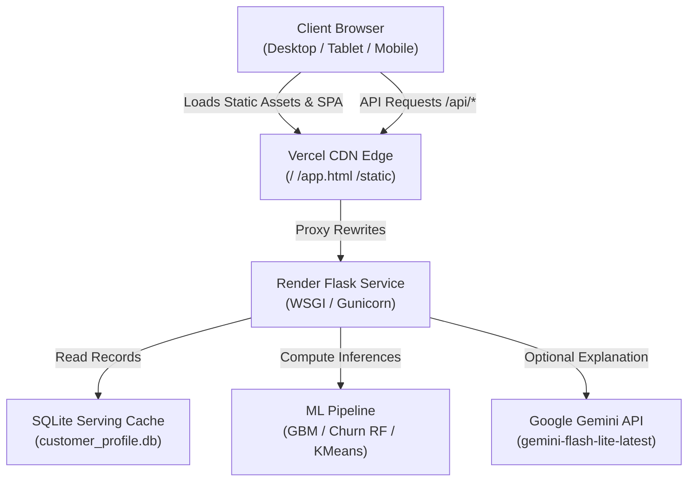

# System Architecture — INSIGHT.arc

## 1. High-Level System Overview
INSIGHT.arc is a dual-tier Retail Customer Intelligence Platform designed for enterprise e-commerce brand monitoring, cohort segmentation, churn prediction, and scenario simulation.

## 2. Frontend Dual-Tier Architecture
1. **Public Production SPA (`frontend/index.html`)**:
   - Single-page application driving the core operational dashboard, customer lookup, 4-cohort segmentation, CLV & churn metrics, simulator, and operations panels.
   - Hash routing engine (`#dashboard`, `#lookup`, `#segmentation`, `#churn`, `#clv`, `#operations`, `#architecture`, `#faq`).
   - Pure vanilla JavaScript with DashFlow CSS tokens ensuring zero cold-start delay and high rendering performance.
2. **React Workspace (`frontend/app.html`)**:
   - React 18 + TypeScript SPA served at `/app` for extended administrative workflows and scenario state persistence.
   - Built and bundled via Vite into `dist/assets/`.

## 3. Mandatory Mirroring Protocol
The repository contains dual representations of frontend assets for standalone static serving and Flask template serving. Any modification must maintain 100% byte-for-byte parity:
- `frontend/index.html` ↔ `web/templates/index.html`
- `frontend/static/css/dashflow.css` ↔ `web/static/css/dashflow.css`
- `frontend/static/js/dashflow.js` ↔ `web/static/js/dashflow.js`

Enforced deterministically by `tests/test_frontend_integrity.py`.
