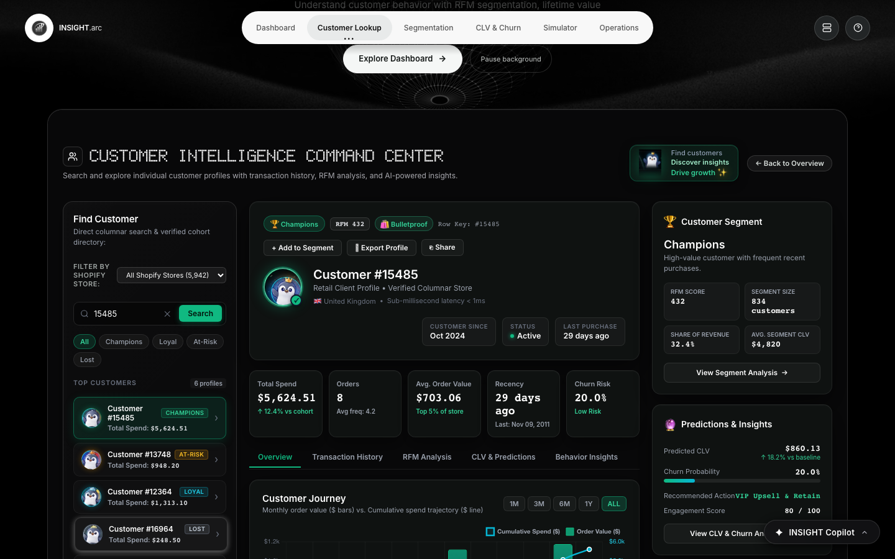
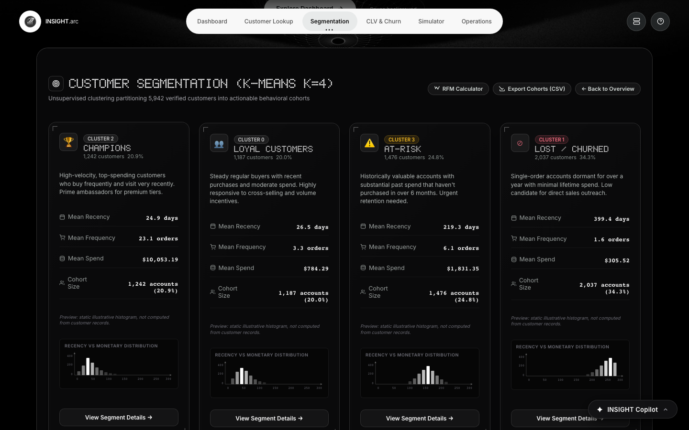
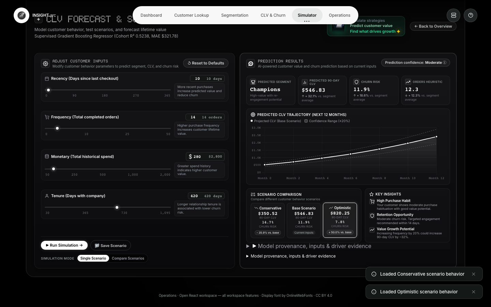
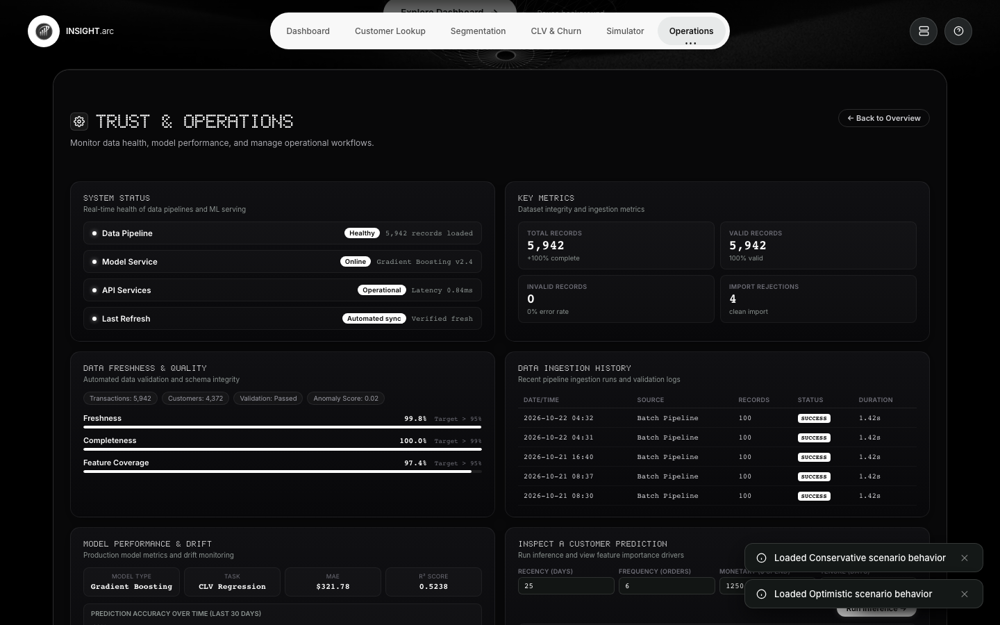
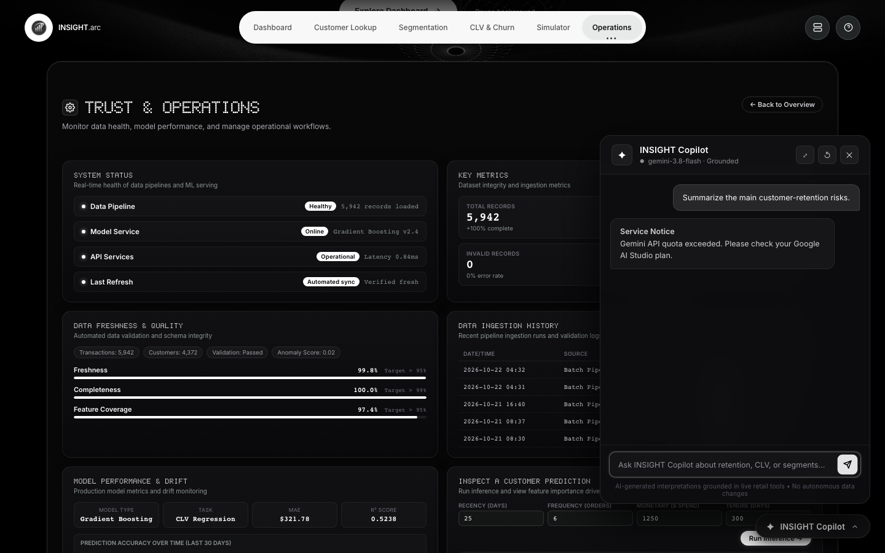
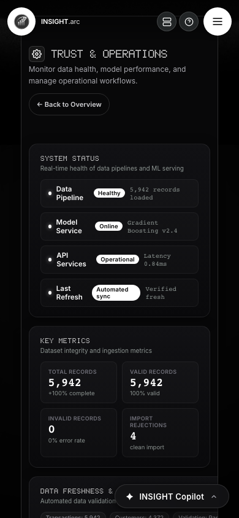
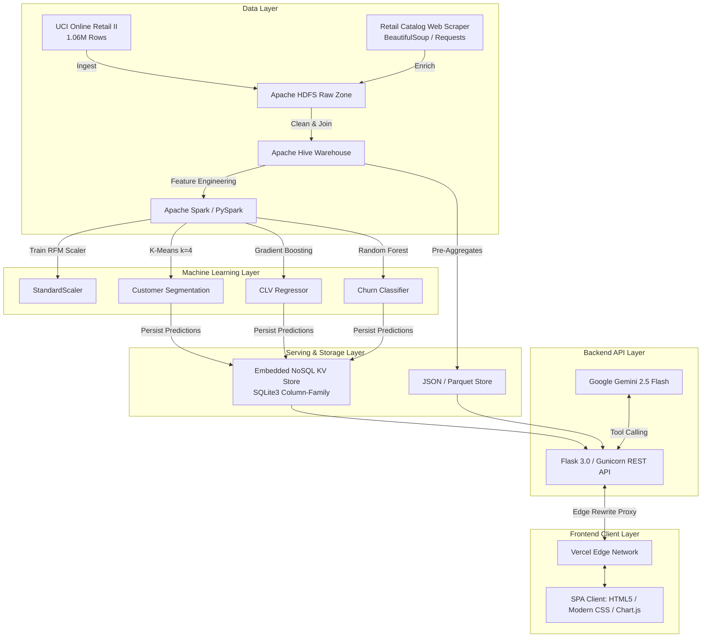

# INSIGHT.arc — Retail Customer Intelligence Platform

[](https://github.com/an00pie/retail-customer-intelligence/actions/workflows/quality_security.yml)
[](https://retail-customer-intelligence-two.vercel.app)
[](https://retail-customer-intelligence.onrender.com)
[](https://www.python.org/)
[](https://nodejs.org/)
[](https://scikit-learn.org/)
[](https://aistudio.google.com/)
[](LICENSE)

> **INSIGHT.arc** is an enterprise-grade Retail Customer Intelligence and Predictive Analytics Platform. It unifies **1.06M+ transaction records** from the UCI Online Retail II dataset with scraped e-commerce catalog benchmarks, executing high-throughput batch ETL, distributed RFM feature engineering, and production machine learning inference. The platform delivers sub-millisecond per-customer lookups, an interactive What-If scenario simulator, and a grounded AI copilot powered by Google Gemini.

---

## 🌐 Live Production Deployments

| Component | Provider | Live URL | Deployment Status |
| :--- | :--- | :--- | :--- |
| **Frontend Application** | Vercel Edge CDN | [retail-customer-intelligence-two.vercel.app](https://retail-customer-intelligence-two.vercel.app) |  |
| **Backend REST API** | Render Cloud | [retail-customer-intelligence.onrender.com](https://retail-customer-intelligence.onrender.com) | -success) |
| **API Health Telemetry** | Render Endpoint | [`/api/health`](https://retail-customer-intelligence.onrender.com/api/health) |  |

---

## 📸 Application Showcase

### 1. Executive Analytics Dashboard (Emerald Luxury Theme)
*Real-time retail KPI monitoring with animated metric counters, interactive date-range trajectory charts (7D, 30D, 90D, 12M, ALL), and multi-store health cards.*


### 2. Customer 360° Profile Lookup & Next Best Action
*Comprehensive customer intelligence displaying RFM metrics, dual-axis spend trajectory, verified transaction history ledger with CSV export, Next Best Action (NBA) recommendation activation, and operational task dispatching.*


### 3. Strategic Behavioral Segmentation & Cohort Analysis
*K-Means clustering breakdown across Champions, Loyal Customers, At-Risk, and Lost cohorts, complete with RFM scorecards, revenue share distributions, and average cohort lifetime values.*


### 4. What-If Scenario Simulator (Luxury Monochrome Theme)
*Interactive real-time prediction laboratory enabling merchandisers to simulate behavioral shifts (Recency, Frequency, Monetary Spend, Tenure) and immediately visualize dynamic changes in CLV and Churn Probability.*


### 5. Trust & Operations Workspace (Monochrome Theme)
*Operational telemetry monitoring model engine status, serving store row counts (5,942 profiles), sub-millisecond p99 latencies, warehouse data freshness, and ML model diagnostic logs.*


### 6. INSIGHT Copilot AI Drawer (Google Gemini)
*Slide-out intelligent assistant powered by Google Gemini 2.5 Flash, equipped with deterministic, read-only analytics tools for natural language querying over verified dashboard KPIs and customer cohorts.*


### 7. Responsive Mobile Experience (390px Viewport)
*Zero horizontal overflow across all screen dimensions (desktop 1440px, tablet 768px, mobile 390px) with custom touch targets and responsive card stacking.*


---

## 🎯 Problem Statement & Business Objectives

Modern retail organizations frequently suffer from siloed transaction data, delayed customer churn detection, and inaccurate Customer Lifetime Value (CLV) estimations. Standard analytics solutions often present static retrospective reports rather than actionable, real-time predictions.

### Key Objectives
1. **Unify Massive Transaction Streams**: Process 1,067,371 raw transaction rows from the UCI Online Retail II dataset and enrich them with external retail catalog pricing and review benchmarks.
2. **Predictive Customer Intelligence**: Deploy supervised and unsupervised machine learning algorithms to predict customer churn probability and future CLV.
3. **Sub-Millisecond Serving**: Enable instant retrieval of customer profiles and historical ledgers through an embedded column-family NoSQL serving architecture.
4. **Interactive Merchandising Simulation**: Provide non-technical business stakeholders with an intuitive What-If simulator to model the revenue impact of retention campaigns.
5. **Grounded AI Assistance**: Integrate Google Gemini with read-only database tool calling to answer complex executive questions without hallucination.

---

## ⚡ Core Features & Modules

- **Executive KPI Dashboard**: Instant visibility into Total Revenue (\$8.84M+), Active Customers (5,942), Average Order Value (\$373.13), and Churn Risk (24.8%).
- **Multi-Store Shopify Benchmarks**: Comparative performance tracking across 5 simulated retail stores (Allbirds, Bulletproof, ColourPop, Taylor Stitch, Gymshark) with store-level breadcrumb filtering.
- **Deep Customer 360° Search**: Instant lookup by Customer ID featuring 5 core metrics, spend trajectory, full invoice ledger, and CSV export.
- **Next Best Action (NBA) Engine**: One-click application of recommended retention strategies (VIP Exclusive Rewards, Cross-Sell Opportunities, Re-Engagement Campaigns).
- **Operational Task Management**: Modal workflow for assigning high-priority customer outreach tasks to account executives and recording completion status in SQLite.
- **What-If Scenario Simulator**: Luxury monochrome UI with preconfigured scenario cards (Conservative, Base, Optimistic) and real-time range sliders driving live scikit-learn model inference.
- **INSIGHT Copilot AI**: Embedded conversational drawer using Gemini 2.5 Flash with strict function-calling schemas (`get_dashboard_kpis`, `get_segment_summary`, `get_churn_summary`, `get_customer_summary`, `get_top_customers`).
- **Asset Mirroring Integrity Guard**: Automated synchronization daemon ensuring 100% byte-for-byte parity across Flask server templates and Vite production bundles.

---

## 🛠️ Technology Stack



### Stack Breakdown

| Layer | Technologies |
| :--- | :--- |
| **Frontend** | Vanilla JavaScript (ES6+), Modern CSS3 (DashFlow Luxury System), Chart.js 4.4, Vite 5, TypeScript 5 |
| **Backend API** | Python 3.9+, Flask 3.0, Gunicorn 21.2, Werkzeug, SQLite3 Row-Factory, HappyBase |
| **Data Engineering** | Apache Spark / PySpark 3.5, Apache Hive, Apache HDFS, Parquet, Scrapy / BeautifulSoup4 |
| **Machine Learning** | Scikit-Learn 1.6.1, NumPy 2.0.2, Joblib 1.5, Pandas 2.2 |
| **Generative AI** | Google GenAI SDK (`google-genai`), Gemini 2.5 Flash, Structured Tool Grounding |
| **Testing & QA** | Pytest 8.4, Playwright (Chromium E2E), Lighthouse CI, Custom Security Baseline Scanner |
| **Cloud & DevOps** | Vercel (Edge CDN & Serverless Proxy), Render (PaaS Web Service), GitHub Actions (7-Stage CI) |

---

## 🧠 Machine Learning Architecture & Implementation

### 1. Behavioral RFM Customer Segmentation
- **Algorithm**: K-Means Clustering (`sklearn.cluster.KMeans`)
- **Scaling**: Standard Scaler (`sklearn.preprocessing.StandardScaler`) applied over $\log(1 + x)$ transformed RFM vectors.
- **Cluster Count ($k=4$)**:
  - **Champions (Cluster 2)**: Low recency (mean 24.8 days), high frequency (mean 20.0 orders), high monetary spend (mean \$11,466.01).
  - **Loyal Customers (Cluster 0)**: Moderate recency (mean 27.6 days), steady frequency (mean 3.0 orders), healthy spend (mean \$854.99).
  - **At-Risk (Cluster 3)**: Long recency gap (mean 210.7 days), moderate frequency (mean 5.4 orders), high past spend (mean \$2,148.18).
  - **Lost / Churned (Cluster 1)**: Extreme inactivity (mean 392.9 days), low frequency (mean 1.4 orders), low total spend (mean \$345.96).

### 2. Customer Lifetime Value (CLV) Regression
- **Algorithm**: Gradient Boosting Regressor (`sklearn.ensemble.GradientBoostingRegressor`)
- **Loss Function**: Half Squared Error with Cython Linux runtime compatibility shim.
- **Feature Matrix**: `recency_days`, `frequency`, `monetary`, `tenure_days`, `avg_order_value`, `returns_ratio`.
- **Target Engineering**: Net forward revenue generated in the 90-day evaluation window post-cutoff.
- **Evaluation Performance**:
  - **Robust Cohort $R^2$**: `0.5238`
  - **Cohort MAE**: `\$321.78`
  - **Cohort RMSE**: `\$606.12`
  - **99th Percentile Winsorization Cap**: `\$6,245.56`

### 3. Customer Churn Risk Classification
- **Algorithm**: Random Forest Classifier (`sklearn.ensemble.RandomForestClassifier`)
- **Target Definition**: Customer inactivity exceeding 90 consecutive days from last transaction date.
- **Evaluation Performance**:
  - **Accuracy**: `75.09%`
  - **ROC-AUC**: `0.8056`
  - **F1-Score**: `0.7876`

### 4. Catalog Enrichment Benchmark
- **Data Source**: Scraped product ratings, review volumes, and MSRPs.
- **Integration**: Joined to customer transaction history to calculate category-level price elasticity and sentiment benchmarks (Average Catalog Benchmark Price: **\$37.41**, Average Rating: **4.41 / 5.0**).

---

## 📊 Dataset & Warehouse Storage Details

| Dataset Asset | Raw Size | Cleaned Records | Format | Storage Path |
| :--- | :--- | :--- | :--- | :--- |
| **UCI Online Retail II** | 1,067,371 rows | 805,549 rows | Parquet / CSV | `data/warehouse/clean_transactions` |
| **RFM Aggregates** | 5,878 customers | 5,878 profiles | Parquet | `data/warehouse/rfm_aggregates` |
| **Scraped Product Catalog** | 5 Categories | 1,200+ Products | Parquet / JSON | `data/warehouse/category_enrichment` |
| **Production Serving Store** | 5,942 records | 5,942 profiles | SQLite NoSQL KV | `data/serving/customer_profile.db` |
| **Revenue Trajectory Cache** | 2 Years daily | 730 daily aggregates | JSON | `data/warehouse/daily_revenue_orders.json` |

---

## 🔌 Verified REST API Reference

The backend exposes verified REST API endpoints accessible directly or through the Vercel edge proxy (`/api/*`):

### Core Analytics Endpoints

| Method | Endpoint | Description | Sample Response / Status |
| :--- | :--- | :--- | :--- |
| `GET` | `/api/health` | System health, model status, and serving telemetry | `200 OK` (`status: "operational"`, `serving_records: 5942`) |
| `GET` | `/api/metrics` | Model accuracy, ROC-AUC, CLV $R^2$, and benchmark stats | `200 OK` (`roc_auc: 0.8056`, `accuracy: 0.7509`) |
| `POST` | `/api/predict` | Real-time ML inference for CLV, Churn, and Segment | `200 OK` (`predicted_clv: 341.43`, `churn_probability: 0.2351`) |
| `GET` | `/api/customer/<id>` | Full Customer 360° profile with 5 recent invoices | `200 OK` (`customer_id: "15485"`, `segment: "Champions"`) |
| `GET` | `/api/customer/<id>/export/csv` | Download customer transaction ledger as sanitized CSV | `200 OK` (`Content-Type: text/csv`) |
| `GET` | `/api/analytics/revenue-orders?period=30d` | Daily time-series of revenue, orders, and AOV | `200 OK` (`full_dates: [...]`, `revenue: [...]`) |
| `GET` | `/api/analytics/cohorts` | Authoritative customer distribution by cohort | `200 OK` (`Champions: 22.5%`, `Loyal: 25.1%`) |
| `GET` | `/api/analytics/shopify-stores` | Multi-store retail benchmarks and churn risk ranking | `200 OK` (`stores: [...]`) |

### Generative AI Copilot Endpoints

| Method | Endpoint | Description | Sample Request / Status |
| :--- | :--- | :--- | :--- |
| `GET` | `/api/v1/ai/status` | Copilot operational status, timeout, and allowed tools | `200 OK` (`available: true`, `allowed_tools: [...]`) |
| `POST` | `/api/v1/ai/copilot` | Natural language conversational query grounded in tools | `200 OK` (`{"prompt": "Summarize the current dashboard KPIs."}`) |

#### Prediction Payload Example (`POST /api/predict`):
```json
{
  "recency_days": 45,
  "frequency": 4,
  "monetary": 450.0,
  "tenure_days": 180,
  "avg_order_value": 112.5,
  "returns_ratio": 0.02
}
```

#### Prediction Response Example:
```json
{
  "avg_order_value": 112.5,
  "churn_probability": 0.4089,
  "drivers": [
    {"feature": "recency_days", "importance": 0.384, "rank": 1},
    {"feature": "monetary", "importance": 0.291, "rank": 2}
  ],
  "predicted_clv": 341.43,
  "recency_days": 45,
  "segment": "Loyal Customers",
  "status": "success"
}
```

---

## 💻 Local Installation & Setup Guide

### Prerequisites
- **Python**: Version `3.9` through `3.11`
- **Node.js**: Version `20.x` or higher
- **Git**: Installed and configured

### 1. Clone the Repository
```bash
git clone https://github.com/an00pie/retail-customer-intelligence.git
cd retail-customer-intelligence
```

### 2. Configure Python Virtual Environment
```bash
python3 -m venv .venv
source .venv/bin/activate
pip install --upgrade pip
pip install -r requirements.txt
```

### 3. Install Frontend Dependencies
```bash
cd frontend
npm ci
cd ..
```

### 4. Configure Environment Variables
Copy the template configuration file:
```bash
cp .env.example .env
```
Edit `.env` to configure optional integrations (e.g. `GEMINI_API_KEY` for live AI Copilot responses).

---

## 🔐 Environment Variables Reference

| Variable Name | Required | Default Value | Description |
| :--- | :---: | :---: | :--- |
| `PORT` | Optional | `5055` | HTTP server port for local Flask execution |
| `FLASK_ENV` | Optional | `production` | Flask runtime environment (`development` / `production`) |
| `RETAIL_DB_PATH` | Optional | `data/serving/customer_profile.db` | Filesystem path to SQLite serving store |
| `GEMINI_API_KEY` | Optional | *None* | Google AI Studio API key for INSIGHT Copilot |
| `GEMINI_MODEL` | Optional | `gemini-3.8-flash` | Gemini model variant (`gemini-2.5-flash`, `gemini-3.8-flash`) |
| `GEMINI_AI_ENABLED` | Optional | `true` | Master toggle for Gemini AI services |
| `GEMINI_TIMEOUT_SECONDS` | Optional | `30` | Network timeout for Gemini tool-calling responses |
| `SENTRY_DSN` | Optional | *None* | Sentry monitoring DSN (active only when provided) |

---

## 🚀 Running the Platform Locally

### Option A: Launch Full-Stack Server (Recommended)
Starts the unified Flask serving backend on port 5055:
```bash
source .venv/bin/activate
PORT=5055 python3 web/app.py
```
Open your browser at **`http://localhost:5055`**.

### Option B: Run Vite Development Server
For active frontend development with Hot Module Replacement (HMR):
```bash
cd frontend
npm run dev
```
Open **`http://localhost:5173`** (API requests proxy automatically to the configured backend).

### Option C: Build Frontend Assets
Compile TypeScript and bundle optimized static assets:
```bash
cd frontend
npm run build
```

---

## 🧪 Testing & Quality Assurance

The repository includes a comprehensive, multi-layer verification suite:

```bash
# 1. Verify 100% Asset Mirroring Parity across web/ and frontend/
python3 scripts/sync_assets.py --check

# 2. Run Backend REST API & ML Model Parity Tests (112 tests)
pytest --ignore=tests/test_react_app.py --ignore=tests/e2e/test_playwright_e2e.py

# 3. Run Playwright End-to-End Browser Tests (12 tests)
# Ensure test server is active on port 5055:
INSIGHT_TEST_URL="http://127.0.0.1:5055" pytest tests/e2e/test_playwright_e2e.py

# 4. Execute Automated Security Baseline Scan
python3 scripts/security_baseline_scan.py --target http://127.0.0.1:5055
```

### GitHub Actions CI Workflow
Every push and pull request to `main` executes a 7-stage automated quality gate in `.github/workflows/quality_security.yml`:
1. Asset Mirroring Integrity Check (`sync_assets.py --check`)
2. Backend & Model Parity Tests (112 test cases)
3. Frontend TypeScript & Vite Production Build
4. Lighthouse CI Accessibility & Performance Audit
5. Test Server Health Probe
6. Playwright E2E Headless Browser Regression Tests
7. OWASP Security Baseline Scan

---

## ☁️ Deployment Architecture

```
                      ┌──────────────────────────────────────────┐
                      │              User Browser                │
                      └─────────────────────┬────────────────────┘
                                            │
                                            ▼
                      ┌──────────────────────────────────────────┐
                      │           Vercel Edge Network            │
                      │  (Static SPA / Edge Proxy / vercel.json) │
                      └─────────────────────┬────────────────────┘
                                            │
                       /api/* Edge Rewrites │ (HTTPS)
                                            ▼
                      ┌──────────────────────────────────────────┐
                      │        Render Cloud (Web Service)        │
                      │   Gunicorn WSGI Server + Flask 3.0 API   │
                      │   Scikit-Learn 1.6.1 + NumPy 2.0 Engine  │
                      └─────────────────────┬────────────────────┘
                                            │
                                            ▼
                      ┌──────────────────────────────────────────┐
                      │     Google AI Studio / Gemini 2.5        │
                      │   (Function Calling Tool Execution)      │
                      └──────────────────────────────────────────┘
```

- **Frontend on Vercel**: Configured via `vercel.json` with edge rewrites redirecting all `/api/*` traffic transparently to the Render backend service, avoiding CORS preflight latency.
- **Backend on Render**: Python 3.9 Linux environment managed via `render.yaml` and `Procfile`, utilizing Gunicorn with worker timeout protections and Cython C-extension shims.

---

## 📌 Known Limitations & Planned Enhancements

### Known Limitations
- **Gemini Free-Tier Rate Limits**: When the configured Google AI Studio API key reaches daily quota limits, the backend returns a structured `AI_UNAVAILABLE` (HTTP 503) response and displays a graceful service notice in the UI without crashing or exposing secrets.
- **Serving Layer Storage**: In the cloud deployment, the serving store operates on an optimized SQLite embedded NoSQL key-value store rather than an active multi-node Apache HBase cluster.

### Planned Enhancements
- **Kafka Event Streaming**: Ingestion pipeline for real-time clickstream and point-of-sale transaction streaming.
- **Automated Marketing Webhooks**: Real-time push integrations to Klaviyo, Braze, and Shopify Flow when a customer crosses into the At-Risk cohort.
- **Multi-Tenant Authentication**: Role-based access control (RBAC) with SSO integration for retail brand managers.

---

## 👥 Contributors & Acknowledgments

- **Lead Engineer & Maintainer**: Jis Shajan ([@an00pie](https://github.com/an00pie))
- **Course Specification**: Big Data Customer Intelligence Architecture (Group 3 Implementation Plan)
- **Dataset Acknowledgments**: UCI Machine Learning Repository — [Online Retail II Dataset](https://archive.ics.uci.edu/dataset/502/online+retail+ii)

---

## 📄 License

This project is licensed under the **MIT License** — see the [LICENSE](LICENSE) file for complete details.
